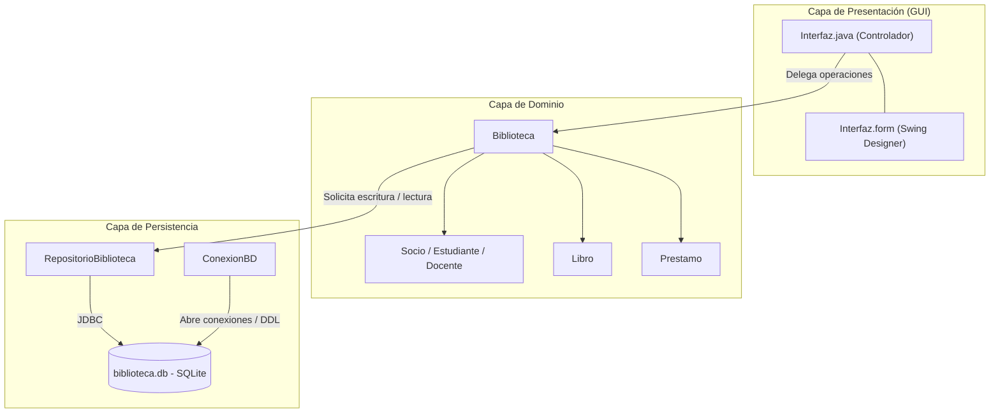

# Documentación de Clase — Interfaz (Menú Gráfico Swing)

**Clase:** `biblioteca.Interfaz`  
**Paquete:** `biblioteca`  
**Diseño visual:** `biblioteca.Interfaz.form` (IntelliJ IDEA Swing UI Designer)  
**Responsable:** Equipo Completo  

---

## 1. Responsabilidad Principal y Arquitectura

La clase `Interfaz` implementa la interfaz gráfica de usuario (GUI) para la gestión integral de la biblioteca, ofreciendo una alternativa visual, ergonómica y moderna al menú de consola tradicional (`GestionBiblioteca`).

Dentro de la arquitectura de la aplicación, `Interfaz` asume el rol coordinado de **Vista y Controlador**:
1. **Presentación visual (Vista):** Expone el estado del dominio mediante ventanas, pestañas (`JTabbedPane`), tablas interactivas (`JTable`), botones de acción (`JButton`), campos de texto (`JTextField`), selectores desplegables (`JComboBox`), cuadros de diálogo (`JOptionPane`) y una barra de estado informativa (`JLabel`).
2. **Control y delegación (Controlador):** Captura las interacciones del usuario (eventos de clic, selección y filtrado), valida las entradas en el cliente, delega las operaciones de negocio y persistencia en la clase `Biblioteca` y actualiza inmediatamente los modelos visuales en memoria.

La clase mantiene un estricto **desacoplamiento**: no contiene consultas SQL ni interactúa directamente con el driver JDBC; cualquier modificación de datos se canaliza a través de `Biblioteca`, la cual garantiza la persistencia en SQLite mediante `RepositorioBiblioteca` antes de impactar las colecciones de objetos en memoria.

---

## 2. Librerías y Herramientas Utilizadas: Justificación Técnica

La implementación de la GUI se apoya en el estándar de la plataforma Java SE y en herramientas integradas de desarrollo profesional:

### 2.1. Cuadro de Paquetes y Librerías

| Librería / Paquete | Componentes Principales Utilizados | Rol en el Proyecto |
| --- | --- | --- |
| `javax.swing.*` | `JFrame`, `JPanel`, `JTabbedPane`, `JTable`, `JButton`, `JLabel`, `JCheckBox`, `JTextField`, `JComboBox`, `JScrollPane`, `JTextArea`, `JOptionPane`, `ListSelectionModel`, `SwingUtilities`, `BorderFactory` | Construcción de todos los componentes visuales ligeros (*lightweight*), diálogos modales y control de ejecución en el hilo de eventos. |
| `javax.swing.table.*` | `DefaultTableModel`, `TableColumnModel` | Gestión desacoplada de los datos tabulares, tipado de columnas para ordenamiento y anchos preferidos. |
| `java.awt.*` | `BorderLayout`, `FlowLayout`, `Dimension`, `Font`, `Color` | Gestores de disposición (*Layout Managers*), dimensionamiento de celdas, fuentes tipográficas y paleta cromática visual. |
| `java.awt.event` | `ActionListener`, `ActionEvent` | Captura las acciones de los botones, la casilla de vencidos y el selector de tipo de socio. |
| `java.util.*` | `Calendar`, `Date`, `HashSet`, `Set`, `ArrayList` | Manejo de fechas para préstamos, colecciones del modelo y optimización de búsquedas de vencimientos en $O(1)$. |
| `biblioteca.persistencia.ConexionBD` | `ConexionBD.inicializarTablas()` | Verificación y preparación del esquema de base de datos SQLite antes del renderizado de la ventana. |
| IntelliJ Swing UI Designer | Plugin nativo de IntelliJ IDEA (`.form`) | Diseño visual asistido con generación automática de código fuente Java en el método `$$$setupUI$$$()`. |

---

### 2.2. Por qué conviene utilizar estas librerías y tecnologías

1. **Nativas en el JDK (Cero dependencias externas):**  
   `javax.swing` y `java.awt` forman parte del núcleo estándar de Java (*Java Foundation Classes*). Esto asegura que la aplicación compile y se ejecute sin requerir gestores de dependencias complejos ni librerías pesadas adicionales (como JavaFX o frameworks web embebidos), garantizando total portabilidad en entornos académicos como **BlueJ** y en cualquier instalación estándar de Java 21.

2. **Alineación con los contenidos de la Cátedra (Tema 6 — POO):**  
   Respeta rigurosamente los conceptos enseñados en la materia: jerarquía de contenedores (`Component` $\to$ `Container` $\to$ `JComponent` $\to$ `JPanel` / `JFrame`), gestores de esquemas estructurados (`BorderLayout`, `FlowLayout`) en lugar de coordenadas fijas (`null layout`), y el modelo de eventos basado en escuchadores (`ActionListener`).

3. **Swing frente a AWT (Componentes Ligeros vs. Pesados):**  
   A diferencia de AWT clásico (cuyos componentes dependen de los pares nativos del sistema operativo y carecen de componentes avanzados), Swing dibuja sus componentes directamente en Java (*lightweight components*). Esto permitió incorporar elementos de alto nivel imposibles en AWT puro:
   - `JTable`: Grillas tabulares completas con encabezados, ordenamiento de filas y selección controlada.
   - `JTabbedPane`: Organización del espacio mediante pestañas temáticas (Libros, Socios, Préstamos) en una única ventana compacta.
   - `JOptionPane`: Cuadros de diálogo modales prediseñados para confirmaciones, advertencias, captura de datos y errores críticos.

4. **Integración con IntelliJ Swing UI Designer y compilación a código Java:**  
   El uso del plugin Swing UI Designer mediante el archivo `Interfaz.form` permitió diseñar la jerarquía de paneles y controles de manera declarativa y visual. Mediante la opción **"Generate GUI into: Java source code"**, el diseñador inyecta directamente la inicialización visual en el método `$$$setupUI$$$()`. Esto brinda dos ventajas decisivas:
   - **Mantenibilidad:** El código manual de lógica (`Interfaz.java`) queda limpio, legible y enfocado en el comportamiento de negocio.
   - **Compatibilidad con BlueJ:** Como el código de armado visual queda materializado en Java estándar dentro de la misma clase, el proyecto puede abrirse y compilarse directamente en BlueJ sin requerir el plugin de IntelliJ instalado.

5. **Seguridad y concurrencia con el EDT (*Event Dispatch Thread*):**  
   Swing no es seguro para subprocesos (*thread-safe*). La inicialización mediante `SwingUtilities.invokeLater` garantiza que la ventana se instancie y actualice estrictamente dentro del hilo de eventos de la interfaz de usuario, evitando bloqueos, corrupción de memoria gráfica o anomalías visuales durante la ejecución.

---

## 3. Atributos y Componentes de la Clase

### 3.1. Componentes Visuales Ligados al Formulario (`Interfaz.form`)

- `private JPanel panelPrincipal`: Contenedor raíz con `BorderLayout`, relleno perimetral de 20 px y fondo gris azulado suave (`#F4F7FB`).
- `private JLabel titulo`: Título de encabezado *"Gestión de Biblioteca"*, tipografía de 26 pt en negrita y color institucional azul marino (`#163854`).
- `private JTabbedPane tabbedPane1`: Panel organizador de pestañas que aloja las tres secciones operativas: **Libros**, **Socios** y **Préstamos**.
- `private JPanel pestañaLibros`, `pestañaSocios`, `pestañaPrestamos`: Paneles contenedores individuales de cada sección, configurados con `BorderLayout`.
- `private JTable tablaLibros`, `tablaSocios`, `tablaPrestamos`: Componentes de grilla donde se visualizan los datos cargados en memoria.
- `private JLabel etiquetaEstado`: Barra inferior de estado y resumen que muestra mensajes de confirmación de operaciones y contadores en tiempo real.
- **Botones de acción:**
  - Sección Libros: `botonRegistrarEjemplar`, `botonTitulos`, `botonTitular` y `botonQuitarEjemplar`.
  - Sección Socios: `botonRegistrarSocio`, `botonBuscarSocio`, `botonCantidadSocios`, `botonDocentesResponsables`, `botonPremiarDocente` y `botonQuitarSocio`.
  - Sección Préstamos: `botonPrestar`, `botonDevolver`.
- **Casilla de verificación:**
  - `private JCheckBox soloVencidos`: Filtro interactivo para restringir la visualización a préstamos activos fuera de término.

### 3.2. Variables de Estado, Modelos y Control de Sesión

- `private static JFrame ventanaActiva`: Referencia estática a la ventana en pantalla. Implementa un patrón similar a *Singleton de ventana* para reutilizar la ventana abierta con `toFront()` y evitar la apertura de múltiples ventanas concurrentes que puedan generar incoherencias.
- `private final Biblioteca biblioteca`: Referencia a la instancia del dominio encargada de coordinar las colecciones y reglas de negocio.
- `private final DefaultTableModel modeloLibros`, `modeloSocios`, `modeloPrestamos`: Modelos de datos independientes que administran las filas y columnas de cada tabla.

---

## 4. Documentación Detallada de Métodos

A continuación se detalla cada uno de los métodos que conforman la clase `Interfaz`, analizando su funcionamiento interno, conceptos aplicados y decisiones de diseño:

---

### Método Constructor: `Interfaz(Biblioteca biblioteca)`

- **Firma:** `private Interfaz(Biblioteca biblioteca)`
- **Qué hace:** Inicializa los modelos de las tres tablas, define los tipos de datos de sus columnas, ajusta los anchos visuales preferidos, conecta los manejadores de eventos en los botones y puebla las tablas con los datos iniciales de la biblioteca.
- **Cómo se implementó y qué conceptos se aplicaron:**
  - Es de visibilidad `private` para impedir la instanciación directa sin el control de arranque de `abrirVentana()`.
  - Invoca al método auxiliar `prepararTabla` para instanciar `DefaultTableModel` con columnas y tipos específicos (`Integer.class`, `String.class`, `Date.class`).
  - Llama a `ajustarColumnas(...)` configurando anchos en píxeles coherentes con el contenido.
  - Invoca `configurarAcciones()` para registrar los *listeners*.
  - Llama a `actualizarTablas("")` para cargar las filas iniciales desde las colecciones de `Biblioteca`.
- **Por qué se eligió esa solución:** Centraliza la preparación de los componentes visuales en un único flujo determinístico, garantizando que cuando la ventana sea visible, los datos y eventos estén perfectamente vinculados.

---

### Método: `main(String[] args)`

- **Firma:** `public static void main(String[] args)`
- **Qué hace:** Constituye el punto de entrada ejecutable para el menú gráfico del TP7.
- **Cómo se implementó:** Pasa un `Runnable` a `SwingUtilities.invokeLater(...)`. Su método `run()` llama a `abrirVentana()`.
- **Por qué se eligió esa solución:** Sigue las buenas prácticas obligatorias de la API de Swing, delegando la creación y manipulación de la GUI en el *Event Dispatch Thread* (EDT) para prevenir condiciones de carrera.

---

### Método: `abrirVentana()`

- **Firma:** `private static void abrirVentana()`
- **Qué hace:** Controla el ciclo de vida de la ventana principal. Trae al frente la ventana si ya está abierta o crea una nueva sesión conectando con SQLite.
- **Cómo se implementó y qué conceptos se aplicaron:**
  - Evalúa `if (ventanaActiva != null && ventanaActiva.isDisplayable())` e invoca `toFront()`.
  - Instancia `new Biblioteca("Biblioteca Central")`.
  - Ejecuta `ConexionBD.inicializarTablas()` y `biblioteca.cargarDesdeBaseDeDatos()` dentro de un `try`. Captura `IllegalStateException` e `IllegalArgumentException` en bloques `catch` separados. Ante cualquiera de las dos excepciones muestra un aviso y termina el arranque.
  - Crea un `JFrame`, asigna `panelPrincipal` como su *ContentPane*, configura `setDefaultCloseOperation(JFrame.DISPOSE_ON_CLOSE)`, establece tamaño mínimo (`760x440`) e inicial (`920x540`), centra la ventana en pantalla con `setLocationRelativeTo(null)` y la hace visible con `setVisible(true)`.
- **Por qué se eligió esa solución:** Protege al usuario frente a bases de datos corruptas o ausentes y previene la apertura de múltiples ventanas simultáneas que compitan por el mismo archivo `biblioteca.db`.

---

### Método: `prepararTabla(JTable tabla, String[] columnas, Class<?>[] tipos)`

- **Firma:** `private static DefaultTableModel prepararTabla(JTable tabla, String[] columnas, Class<?>[] tipos)`
- **Qué hace:** Configura y asocia un modelo de tabla (`DefaultTableModel`) con bloqueo de edición directa de celdas y tipado estricto de columnas, activando el ordenamiento automático y la selección simple.
- **Cómo se implementó y qué conceptos se aplicaron:**
  - Instancia una clase anónima que extiende de `DefaultTableModel`.
  - Sobrescribe `isCellEditable(int fila, int columna)` retornando siempre `false`.
  - Sobrescribe `getColumnClass(int columna)` retornando `tipos[columna]`.
  - Asigna el modelo a la tabla con `tabla.setModel(modelo)`.
  - Habilita `tabla.setAutoCreateRowSorter(true)` y establece `ListSelectionModel.SINGLE_SELECTION`.
- **Por qué se eligió esa solución:**
  - **Integridad de datos:** Bloquear la edición directa evita modificaciones accidentales que no pasarían por las validaciones de `Biblioteca` ni por SQLite.
  - **Ordenamiento tipado:** Al indicar la clase de cada columna, el `TableRowSorter` de Swing ordena los números (ID, DNI, plazos) de forma numérica ($1, 2, 10$ y no $1, 10, 2$) y las fechas de manera cronológica.

---

### Método: `ajustarColumnas(JTable tabla, int[] anchos)`

- **Firma:** `private static void ajustarColumnas(JTable tabla, int[] anchos)`
- **Qué hace:** Recibe un arreglo de enteros con los anchos preferidos de las columnas en píxeles.
- **Cómo se implementó y qué conceptos se aplicaron:** Recorre el arreglo con un bucle `for` tradicional y aplica `tabla.getColumnModel().getColumn(i).setPreferredWidth(anchos[i])`.
- **Por qué se eligió esa solución:** Mejora sustancialmente la legibilidad visual, reservando mayor espacio para campos largos (como el título del libro o la carrera) y dimensiones compactas para identificadores numéricos.

---

### Método: `configurarAcciones()`

- **Firma:** `private void configurarAcciones()`
- **Qué hace:** Asocia cada botón y la casilla de verificación con sus respectivos métodos de acción.
- **Cómo se implementó:** `Interfaz` implementa `ActionListener` y se registra en los controles con `addActionListener(this)`. `actionPerformed(ActionEvent evento)` consulta `evento.getSource()` para identificar el control y llamar al método correspondiente.
- **Por qué se eligió esa solución:** Sigue el esquema de eventos del apunte de interfaz gráfica y reúne el registro de los controles en un mismo método.

---

### Método: `actualizarTablas(String mensaje)`

- **Firma:** `private void actualizarTablas(String mensaje)`
- **Qué hace:** Sincroniza las tres tablas visuales con los datos que residen en las colecciones en memoria de la biblioteca.
- **Cómo se implementó y qué conceptos se aplicaron:**
  - Limpia el modelo de libros con `modeloLibros.setRowCount(0)` y lo puebla recorriendo `biblioteca.getLibros()` con `addRow(...)`. Determina el estado evaluando `libro.prestado() ? "Prestado" : "Disponible"`.
  - Limpia el modelo de socios con `modeloSocios.setRowCount(0)` y recorre `biblioteca.getSocios()`. Usa el método polimórfico `socio.soyDeLaClase()`, el auxiliar `carreraOArea(socio)` y `socio.cantLibrosPrestados()`.
  - Delega en `actualizarPrestamos(mensaje)` para completar la tabla de préstamos y la barra de estado.
- **Por qué se eligió esa solución:** Garantiza la coherencia visual absoluta tras cada inserción, devolución o préstamo, reflejando de forma inmediata cualquier cambio de estado en el catálogo y el padrón.

---

### Método: `actualizarPrestamos(String mensaje)`

- **Firma:** `private void actualizarPrestamos(String mensaje)`
- **Qué hace:** Puebla la tabla de préstamos activos, aplica el filtro de préstamos vencidos y calcula las estadísticas generales para la barra de estado.
- **Cómo se implementó y qué conceptos se aplicaron:**
  - Vacía `modeloPrestamos`.
  - Obtiene los préstamos vencidos invocando `biblioteca.prestamosVencidos()` y los vuelca en un `new HashSet<>(...)`. El uso de `Set` permite comprobar en tiempo constante $O(1)$ si un préstamo está fuera de término mediante `vencidos.contains(prestamo)`.
  - Recorre los libros de la biblioteca, filtra aquellos con préstamo activo (`fechaDevolucion == null`), verifica el estado del filtro `soloVencidos.isSelected()` y agrega las filas correspondientes.
  - Concatena las métricas globales (ejemplares, socios, préstamos activos y préstamos vencidos) y actualiza el texto de `etiquetaEstado`.
- **Por qué se eligió esa solución:** Combina la actualización de la tabla con el cálculo del resumen del sistema en un único recorrido eficiente, informando al usuario tanto el resultado de la última acción como el estado global de la biblioteca.

---

### Método: `registrarEjemplar()`

- **Firma:** `private void registrarEjemplar()`
- **Qué hace:** Despliega un formulario interactivo para dar de alta un nuevo ejemplar en el catálogo y persistirlo en SQLite.
- **Cómo se implementó y qué conceptos se aplicaron:**
  - Crea componentes `JTextField` para título, edición, editorial y año.
  - Delega la interacción en el auxiliar `confirmarYGuardar`.
  - La operación valida campos obligatorios mediante `textoRequerido` y números positivos con `enteroPositivo`.
  - Llama a `biblioteca.nuevoLibro(...)`, que inserta el registro en SQLite a través del repositorio y añade el objeto `Libro` a la lista en memoria.
- **Por qué se eligió esa solución:** Encapsula la validación sintáctica de los datos antes de crear el objeto, evitando inconsistencias o fallos por datos nulos o vacíos.

---

### Método: `registrarSocio()`

- **Firma:** `private void registrarSocio()`
- **Qué hace:** Presenta un diálogo adaptativo para registrar un nuevo socio (Estudiante o Docente), validando la unicidad del DNI antes del alta.
- **Cómo se implementó y qué conceptos se aplicaron:**
  - Utiliza un `JComboBox<String>` con las opciones *"Estudiante"* y *"Docente"*.
  - Añade un `ActionListener` dinámico al combo para alternar la etiqueta del campo de detalle entre *"Carrera"* y *"Área"* según la selección.
  - Al confirmar, comprueba que el DNI no exista previamente (`biblioteca.buscarSocio(documento) != null`). De existir, lanza `IllegalArgumentException`.
  - Según el tipo seleccionado, invoca `biblioteca.nuevoSocioEstudiante(...)` o `biblioteca.nuevoSocioDocente(...)`.
- **Por qué se eligió esa solución:** Adapta la interfaz en tiempo real al modelo polimórfico de clases del dominio, reutilizando los mismos campos de entrada para ambas subclases de `Socio`.

---

### Método: `prestarEjemplar()`

- **Firma:** `private void prestarEjemplar()`
- **Qué hace:** Permite registrar un nuevo préstamo asociando un ejemplar disponible con un socio registrado, aplicando todas las reglas de negocio del dominio.
- **Cómo se implementó y qué conceptos se aplicaron:**
  - Recorre `biblioteca.getLibros()` con `for-each` y agrega a un `ArrayList` las opciones para los ejemplares disponibles.
  - Si no hay ejemplares disponibles o no hay socios, interrumpe con `avisar(...)`.
  - Muestra un selector desplegable (`JComboBox<Ejemplar>`) y un campo para el DNI del socio.
  - Al presionar Aceptar, busca al socio con `biblioteca.buscarSocio(...)`. Si no existe, lanza `IllegalArgumentException`.
  - Ejecuta `biblioteca.prestarLibro(Calendar.getInstance(), socio, libro)`. Si la biblioteca retorna `false` (debido a que el socio tiene préstamos vencidos o excedió su límite de préstamos), se lanza `IllegalArgumentException` informando el motivo del rechazo.
- **Por qué se eligió esa solución:** El uso del selector con objetos envueltos en `Ejemplar` asegura que el usuario solo pueda intentar prestar libros realmente disponibles, mientras que la lógica de autorización se delega íntegramente en las reglas de `Socio` y `Biblioteca`.

---

### Métodos `quitarEjemplar()` y `quitarSocio()`

Cada método toma el ID o DNI de la fila seleccionada con `claveSeleccionada(...)` y pide confirmación. Si se confirma, llama a `Biblioteca.quitarLibro(...)` o `Biblioteca.quitarSocio(...)`. Al terminar con éxito, actualiza las tablas y la barra de estado. Cuando falta la selección, el registro ya no existe o la baja es rechazada, la interfaz muestra un mensaje.

---

### Método: `devolverEjemplar()`

- **Firma:** `private void devolverEjemplar()`
- **Qué hace:** Registra la devolución del préstamo activo correspondiente al ejemplar seleccionado en la tabla de préstamos.
- **Cómo se implementó y qué conceptos se aplicaron:**
  - Obtiene el ID del ejemplar mediante `claveSeleccionada(tablaPrestamos, ...)`.
  - Busca la instancia con `biblioteca.buscarLibro(id)`.
  - Solicita confirmación explícita mediante `JOptionPane.showConfirmDialog(..., YES_NO_OPTION)`.
  - En caso afirmativo, invoca `biblioteca.devolverLibro(libro)` dentro de un bloque `try-catch`:
    - Captura la excepción comprobada del proyecto `LibroNoPrestadoException` y notifica con `avisar(e.getMessage())`.
    - Captura la excepción no comprobada de persistencia `IllegalStateException` y notifica con `mostrarError(e)`.
  - Al completar la devolución, refresca la GUI con `actualizarTablas("Devolución registrada")`.
- **Por qué se eligió esa solución:** Incorpora una confirmación de seguridad para evitar devoluciones accidentales y maneja de forma diferenciada las excepciones del dominio y las de la base de datos.

---

### Método: `consultarTitular()`

- **Firma:** `private void consultarTitular()`
- **Qué hace:** Informa el nombre del socio que tiene actualmente en su poder el ejemplar seleccionado en la tabla de libros.
- **Cómo se implementó y qué conceptos se aplicaron:**
  - Obtiene el ID del libro con `claveSeleccionada(tablaLibros, ...)`.
  - Invoca `biblioteca.quienTieneElLibro(libro)`.
  - Si el libro está prestado, muestra el nombre del socio; si está disponible en la biblioteca, captura `LibroNoPrestadoException` y muestra su mensaje explicativo de forma transparente mediante `informar(...)`.
- **Por qué se eligió esa solución:** Permite consultar el estado de cualquier libro directamente desde la pestaña de catálogo sin necesidad de buscar manualmente en la pestaña de préstamos.

---

### Método: `buscarSocio()`

- **Firma:** `private void buscarSocio()`
- **Qué hace:** Solicita un número de documento, localiza al socio en la colección, selecciona y enfoca visualmente su fila en la tabla de socios y muestra una ficha completa con sus datos.
- **Cómo se implementó y qué conceptos se aplicaron:**
  - Pide el DNI mediante `JOptionPane.showInputDialog(...)`.
  - Valida el formato numérico con `entero(dni, "DNI")` y busca la instancia con `biblioteca.buscarSocio(documento)`.
  - Recorre las filas del modelo `modeloSocios`. Al encontrar coincidencia de DNI, realiza la conversión de coordenadas:  
    `int visible = tablaSocios.convertRowIndexToView(fila);`
  - Selecciona la fila con `tablaSocios.setRowSelectionInterval(visible, visible)` y asegura su visualización mediante `tablaSocios.scrollRectToVisible(...)`.
  - Despliega un diálogo informativo con todos los atributos del socio: nombre, tipo, DNI, carrera o área, días de plazo y cantidad de libros prestados.
- **Por qué se eligió esa solución:**
  - **Mapeo Vista-Modelo:** El uso de `convertRowIndexToView` es crítico para que la búsqueda funcione con exactitud matemática aun cuando el usuario haya ordenado la tabla por otra columna (por ejemplo, alfabéticamente por nombre).
  - **Usabilidad:** Combina la retroalimentación textual con la selección y desplazamiento automático de la grilla.

---

### Método: `mostrarCantidades()`

- **Firma:** `private void mostrarCantidades()`
- **Qué hace:** Muestra la cantidad total de estudiantes y docentes registrados en el sistema.
- **Cómo se implementó y qué conceptos se aplicaron:** Invoca `biblioteca.cantidadDeSociosPorTipo("Estudiante")` y `biblioteca.cantidadDeSociosPorTipo("Docente")`, presentando los resultados en un diálogo informativo `JOptionPane.INFORMATION_MESSAGE`.
- **Por qué se eligió esa solución:** Aprovecha el método polimórfico del dominio que compara dinámicamente mediante `soyDeLaClase()`.

---

### Método: `premiarDocente()`

- **Firma:** `private void premiarDocente()`
- **Qué hace:** Evalúa si el docente seleccionado en la tabla de socios cumple la condición de responsabilidad y, en caso positivo, permite sumar días a su plazo de préstamo.
- **Cómo se implementó y qué conceptos se aplicaron:**
  - Obtiene el DNI del socio seleccionado en `tablaSocios` con `claveSeleccionada`.
  - Busca al socio, comprueba su tipo con `instanceof`, lo convierte explícitamente a `Docente` y verifica `esResponsable()`. Si alguna condición falla, avisa y cancela.
  - Solicita los días adicionales con un diálogo modal.
  - Valida que sea un entero positivo y previene el desbordamiento aritmético evaluando `(long) docente.getDiasPrestamo() + aumento > Integer.MAX_VALUE`.
  - Invoca `biblioteca.actualizarDiasDocente(docente, aumento)`, actualizando SQLite y el objeto en memoria.
- **Por qué se eligió esa solución:** Garantiza la seguridad de tipos (*type safety*) mediante downcasting seguro y protege la integridad de la base de datos contra valores inválidos o desbordamientos numéricos.

---

### Método: `confirmarYGuardar(String tituloDialogo, Object[] campos, Runnable operacion, String mensaje)`

- **Firma:** `private void confirmarYGuardar(String tituloDialogo, Object[] campos, Runnable operacion, String mensaje)`
- **Qué hace:** Coordina de manera genérica el ciclo de vida de los formularios emergentes de inserción y modificación de datos.
- **Cómo se implementó y qué conceptos se aplicaron:**
  - Ejecuta un bucle `while` centrado en `JOptionPane.showConfirmDialog(panelPrincipal, campos, tituloDialogo, OK_CANCEL_OPTION, PLAIN_MESSAGE)`.
  - Ejecuta `operacion.run()`. Cada formulario implementa `run()` para validar sus datos y llamar a `Biblioteca`.
  - **Manejo diferenciado de excepciones:**
    - Si se produce `IllegalArgumentException` (error de validación en la entrada del usuario), muestra una advertencia con `avisar(e.getMessage())` y continúa el bucle (`continue`). Esto permite al usuario corregir el dato mal ingresado **sin perder lo que ya había escrito** en los demás campos.
    - Si se produce `IllegalStateException` (fallo de persistencia en SQLite), informa con `mostrarError(e)` y finaliza el método con `return` para proteger el estado.
  - Si la operación concluye con éxito, llama a `actualizarTablas(mensaje)` y termina.
- **Por qué se eligió esa solución:** Constituye un patrón de diseño reutilizable de alto nivel que evita la duplicación de código en todos los formularios modales y optimiza significativamente la experiencia de usuario (UX).

---

### Método: `claveSeleccionada(JTable tabla, String indicacion)`

- **Firma:** `private Integer claveSeleccionada(JTable tabla, String indicacion)`
- **Qué hace:** Recupera la clave principal (ID o DNI, situada en la columna 0 del modelo) de la fila seleccionada por el usuario en una tabla.
- **Cómo se implementó y qué conceptos se aplicaron:**
  - Consulta `tabla.getSelectedRow()`. Si es menor que cero, muestra el mensaje de advertencia pasado por parámetro y devuelve `null`.
  - Convierte el índice visual al índice real del modelo subyacente mediante `tabla.convertRowIndexToModel(fila)`.
  - Retorna `(Integer) tabla.getModel().getValueAt(filaModelo, 0)`.
- **Por qué se eligió esa solución:** Es fundamental para evitar errores graves de referencia cuando la tabla está ordenada. Si el usuario ordenó la tabla por título o fecha, la fila visual $0$ puede corresponder a la fila $15$ del modelo; este método garantiza obtener siempre el objeto correcto.

---

### Métodos Auxiliares de Validación y Conversión

#### `carreraOArea(Socio socio)`
- **Firma:** `private static String carreraOArea(Socio socio)`
- **Qué hace:** Extrae la carrera o el área según si el socio es un `Estudiante` o un `Docente`.
- **Cómo funciona:** Usa `instanceof Estudiante` y una conversión explícita a `Estudiante` para obtener `getCarrera()`. Para un docente, convierte el objeto a `Docente` y llama a `getArea()`.
- **Justificación:** Resuelve de forma limpia la visualización en la columna compartida de la grilla de socios.

#### `textoRequerido(JTextField campo, String nombre)`
- **Firma:** `private static String textoRequerido(JTextField campo, String nombre)`
- **Qué hace:** Lee el texto de un control, elimina los espacios en blanco de los extremos con `strip()` y valida que no quede vacío.
- **Excepciones:** Lanza `IllegalArgumentException("Completá el campo «" + nombre + "».")` si el campo está en blanco.

#### `entero(String texto, String nombre)`
- **Firma:** `private static int entero(String texto, String nombre)`
- **Qué hace:** Convierte una cadena en un valor de tipo primitivo `int` mediante `Integer.parseInt(texto.strip())`.
- **Excepciones:** Captura `NumberFormatException` y lanza `IllegalArgumentException("Ingresá un número entero en «" + nombre + "».")`.

#### `enteroPositivo(String texto, String nombre)`
- **Firma:** `private static int enteroPositivo(String texto, String nombre)`
- **Qué hace:** Reutiliza `entero(...)` y comprueba que el valor sea estrictamente mayor que cero (`valor > 0`).
- **Excepciones:** Lanza `IllegalArgumentException` si el valor es menor o igual a cero.

---

### Métodos Auxiliares de Diálogos y Notificaciones

#### `mostrarListado(String tituloDialogo, String contenido)`
- **Firma:** `private void mostrarListado(String tituloDialogo, String contenido)`
- **Qué hace:** Despliega reportes de texto extenso (como títulos únicos o docentes responsables) en un cuadro emergente.
- **Cómo funciona:** Configura un `JTextArea` de solo lectura (`setEditable(false)`), con ajuste de línea por palabra (`setLineWrap(true)`, `setWrapStyleWord(true)`), envuelto en un `JScrollPane`. Se presenta mediante `informar(...)`.

#### `informar(String tituloDialogo, Object mensaje)`
- **Firma:** `private void informar(String tituloDialogo, Object mensaje)`
- **Qué hace:** Muestra un cuadro modal informativo (`JOptionPane.INFORMATION_MESSAGE`).

#### `avisar(String mensaje)`
- **Firma:** `private void avisar(String mensaje)`
- **Qué hace:** Muestra un cuadro modal de advertencia (`JOptionPane.WARNING_MESSAGE`) con el encabezado *"Revisá la operación"*.

#### `mostrarError(IllegalStateException error)`
- **Firma:** `private void mostrarError(IllegalStateException error)`
- **Qué hace:** Muestra un cuadro modal de error crítico (`JOptionPane.ERROR_MESSAGE`) cuando falla una operación en la base de datos SQLite.

---

### Clase auxiliar `Ejemplar`

- **Qué hace:** Guarda un `Libro` en un atributo que se asigna en el constructor. Cada instancia representa una opción del selector de préstamos.
- **Sobrescritura de `toString()`:** Devuelve `"#<ID> · <Título>"`.
- **Por qué se eligió esa solución:** `JComboBox` muestra el ID y el título mediante `toString()`. El ID permite distinguir dos ejemplares de la misma obra y la clase conserva el objeto `Libro` elegido.

---

### Método de Inicialización: `$$$setupUI$$$()`

- **Firma:** `private void $$$setupUI$$$()`
- **Qué hace:** Construye e inicializa la jerarquía completa de componentes Swing declarados en el archivo `Interfaz.form`.
- **Cómo funciona:**
  - Define la paleta de colores del sistema (`superficie = #FFFFFF`, `texto = #172D42`, `lineas = #E3EAF1`, `seleccion = #DCEBFA`).
  - Configura el `BorderLayout` del panel raíz y los paneles secundarios.
  - Instancia y personaliza las tres tablas `JTable`: establece altura de fila a 25 px (`setRowHeight(25)`), espaciado intercelular de 8x1 px, líneas horizontales visibles, fondo de selección distintivo y ajuste vertical en el scroll (`setFillsViewportHeight(true)`).
  - Ensambla las barras de herramientas inferiores con `FlowLayout(FlowLayout.RIGHT, 8, 5)` para agrupar los botones a la derecha.
  - Asigna las pestañas *"Libros"*, *"Socios"* y *"Préstamos"* al `JTabbedPane`.
  - Configura la barra de estado inferior.
- **Por qué se eligió esa solución:** Es el código autogenerado por el compilador de formularios de IntelliJ IDEA. Al estar volcado en el código fuente Java, garantiza que cualquier entorno (incluyendo BlueJ) pueda levantar la interfaz gráfica con exactitud visual idéntica sin necesidad de procesar el archivo XML `.form` en tiempo de ejecución.

---

## 5. Conceptos de POO y Patrones de Diseño Aplicados

1. **Separación de Responsabilidades y Patrón MVC:**  
   `Interfaz` actúa como controlador visual. Toda la lógica de negocio (cuándo puede prestarse un libro, cómo se calculan los vencimientos, qué docente es responsable) permanece estrictamente en el modelo (`Biblioteca`, `Socio`, `Libro`, `Prestamo`). La persistencia permanece en `RepositorioBiblioteca`.

2. **Programación Dirigida por Eventos (*Event-Driven Programming*):**  
   Swing llama a `actionPerformed(...)` cuando el usuario activa un control registrado con `ActionListener`.

3. **Polimorfismo y Enlace Dinámico:**  
   Se aprovecha en la lectura de socios (`socio.soyDeLaClase()`), en la evaluación de condiciones de préstamo (`socio.puedePedir()`) y en la diferenciación visual entre estudiantes y docentes.

4. **Encapsulamiento y Visibilidad Estricta:**  
   Los componentes y métodos internos son privados. `main(String[] args)` es el punto de entrada y `actionPerformed(ActionEvent evento)` es el método público que exige `ActionListener`.

5. **Manejo Integral de Excepciones (Verificadas y No Verificadas):**  
   - Las validaciones de formato lanzan y capturan `IllegalArgumentException` sin cerrar los formularios.
   - Las reglas del dominio con excepciones propias de la aplicación (`LibroNoPrestadoException`, verificada) se capturan e informan amigablemente.
   - Las fallas de infraestructura en SQLite (`IllegalStateException`, no verificada) se notifican mediante cuadros de error explícitos, impidiendo la corrupción de los datos en memoria.
